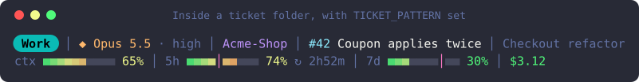
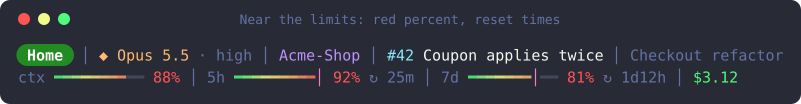
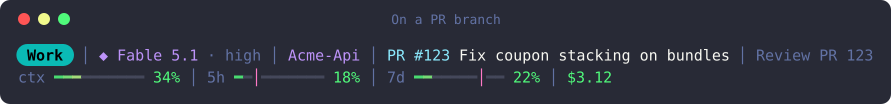
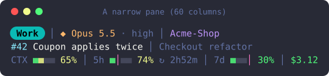

# claude-code-statusline

**Are you using your Claude limits faster than they refill?** This two-row status line for
[Claude Code](https://docs.claude.com/en/docs/claude-code) answers that at a glance. The 5-hour
and 7-day usage bars each carry a pink pace marker, showing how much of the window has passed.
When the fill runs ahead of the marker, you are on track to hit the limit before it resets.

It also shows:

- **which Claude login** is active, as a coloured chip (handy if you switch accounts);
- **which model and effort level** is running;
- **which project and PR** you are on, read from your folder and branch names (and, if you
  opt in, which ticket);
- **how full the context window is**, and what the session has cost so far.



The images on this page are drawn from made-up sessions by `tools/screenshots.sh`.

## What each part means

**Row 1**: account chip │ model · effort │ project folder (· git branch) │ ticket or PR │ session name

| Part | Where it comes from |
|---|---|
| Account chip | Which Claude login is active, read from `~/.claude.json` (`oauthAccount.emailAddress`). Useful if you switch between accounts, with `/login` or a tool such as [claude-swap](https://github.com/realiti4/claude-swap): name each login and give it a colour in the config (the screenshots use "Work" and "Home"). Without a config it shows the part of your address before the `@`, in grey. One login and no need for it? `SHOW_ACCOUNT=0` hides it. |
| ◆ Model · effort | Claude Code's status JSON. Opus is orange, Fable purple, anything else cyan. |
| Folder · branch | The project folder name and current git branch. Inside a ticket folder it still shows the project folder above it. |
| Ticket | Optional, off by default. If you keep one folder per ticket and set `TICKET_PATTERN`, the ticket folder you are in, e.g. `tickets/2026-10-28 [#42] Coupon-applies-twice`, shows as **#42 Coupon applies twice**. A folder ending in ` - DONE` adds *(done)*. |
| PR | From a branch named like `pr/123`, `fix/pr-123` or `feature-pr123`. The title is fetched with `gh pr view` in the background and cached for an hour, so the line never waits on the network. |
| Session name | Set with `/rename`, or `CLAUDE_TASK=...`. It is shortened, or dropped, before anything else when the pane is narrow. |

**Row 2**: ctx (context window) │ 5h │ 7d │ cost

- Bars fill green → yellow → orange → red along the track. The percent is green below 50%,
  yellow to 79%, red from 80%.
- The pink **│** on the 5h and 7d bars is **pace**: how much of that window has already
  passed. Fill ahead of the marker means you are using the limit faster than it refills.
- **↻ 2h52m** is the time until that limit resets. It only appears once a limit reaches 70%.
- Bar cells are ■, which sits on the text baseline like a letter, so the bars line up with the labels and
  percents. Measured in Hack Nerd Font Mono and MesloLGS NF, where ■ fills the cell; a font that draws it
  narrower shows thin gaps between cells. Check yours with `swift tools/glyph-metrics.swift <font.ttf>`.





In a narrow pane the line wraps by whole parts and the bars shrink, never past three lines:



## Requirements

- **zsh** and **jq**.
- A terminal with 24-bit colour (Warp, iTerm2, WezTerm, Kitty, Ghostty).
- Optional: **[gh](https://cli.github.com)**, logged in, for PR titles.
- Optional: a **[Nerd Font](https://www.nerdfonts.com)** for the rounded chip ends (`PILL=1`).

Tested on macOS. The script uses only zsh built-ins and POSIX tools (`cksum`, `zstat`) for
its caches, so Linux should work, but it has not been tested there yet.

## Install

Already have a `~/.claude/statusline.sh`? Back it up first, because the copy below replaces it:
`cp ~/.claude/statusline.sh ~/.claude/statusline.sh.bak`.

```sh
git clone https://github.com/Rat01047/claude-code-statusline.git
cp claude-code-statusline/statusline.sh ~/.claude/statusline.sh
chmod +x ~/.claude/statusline.sh
```

Then add the `statusLine` block to `~/.claude/settings.json`. If the file already has other
settings, add the block next to them; don't replace the file:

```json
{
  "statusLine": {
    "type": "command",
    "command": "~/.claude/statusline.sh",
    "padding": 0
  }
}
```

The new line shows on the next refresh of each Claude Code session.

## Configure

Everything works without a config file. To name your logins and colour their chips, copy the
example and edit it:

```sh
mkdir -p ~/.config/claude-statusline
cp claude-code-statusline/config.example.zsh ~/.config/claude-statusline/config.zsh
```

| Setting | Default | What it does |
|---|---|---|
| `SHOW_ACCOUNT` | `1` | `0` hides the account chip and never reads `~/.claude.json`. |
| `ACCOUNTS` | none | `'email\|Label\|bg r;g;b\|text r;g;b'`, one per login. |
| `PILL` | `0` | `1` gives the chip rounded ends (needs a Nerd Font). |
| `TICKET_PATTERN` | `''` (off) | Regex for your ticket folders; the first group is the folder's name. The example config has `'/tickets/([^/]+)'`. |
| `TICKET_MAX` | `40` | Longest ticket title shown. |
| `PR_TITLES` | `1` | `0` never calls `gh`. |

Set `CLAUDE_STATUSLINE_CONF` to keep the file somewhere else. The file runs as zsh code, so
it is skipped unless you own it and it is not world-writable.

## What it reads, runs and writes

So you know before you install it:

- **Reads** the status JSON Claude Code passes on stdin, and `oauthAccount.emailAddress` from
  `~/.claude.json` (or `$CLAUDE_CONFIG_DIR/.claude.json`). Nothing else in that file, and not
  even that with `SHOW_ACCOUNT=0`.
- **Runs** `git` in your working folder (branch name, cached 5 seconds) and, when you are on a
  PR branch and `PR_TITLES=1`, `gh pr view <number> --json title` in the background.
- **Writes** small cache files to `$TMPDIR/claude-statusline-<uid>/`, a folder only you can
  read (mode 700). If that folder is a link, belongs to someone else or is open to others
  (another user got there first in a shared `/tmp`), nothing is cached and no PR title is
  fetched; the line still works.
- **Prints names as text.** Control characters are removed from folder, ticket, branch, model
  and session names, so a name carrying terminal escape codes cannot retitle or clear your
  window. A PR number must be digits before it reaches `gh`.
- Sends nothing anywhere itself; `gh` talks to GitHub the way it always does.

## Tests

```sh
zsh tests/run.sh
```

The tests drive the script with made-up accounts (`work@example.com`, `home@example.com`) and
folders (`Acme-Shop`) in a throwaway HOME, so they never read your real login or caches. They
check the layout, colours, bar fill and pace marker, wrapping at five pane widths, every config
switch, the git and PR handling (with a stand-in `gh`), and the cache folder's permissions.

To redraw the screenshots: `zsh tools/screenshots.sh`, then `zsh tools/social-preview.sh` for the
social preview image (macOS).

## Credits

The bar's gradient, pace marker and percent bands are adapted from
[briansmith80/claude-code-status-bar](https://github.com/briansmith80/claude-code-status-bar)
(MIT). Colours are from [Dracula](https://draculatheme.com). See
[THIRD-PARTY.md](THIRD-PARTY.md).

## License

[MIT](LICENSE)
